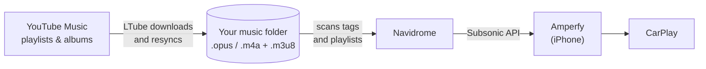

# LTube

[](https://github.com/terjokhin/LTube/tags)

**Download your YouTube Music playlists and albums into your own music library, and keep them in sync.**

LTube is a small self-hosted web app (and CLI) built on [yt-dlp](https://github.com/yt-dlp/yt-dlp). Paste a playlist or album link and it downloads every track as a properly tagged audio file, with cover art, into a folder you choose. Every track is stored once, however many playlists and albums contain it, and later you can resync a playlist: only the tracks you don't have yet are fetched.

> [!IMPORTANT]
> **Use LTube legally.** Only download content you have the right to download: your own uploads, content whose license allows it, or what the laws of your country and YouTube's [Terms of Service](https://www.youtube.com/t/terms) permit for personal use. You are solely responsible for how you use this software. LTube is not affiliated with, endorsed by, or sponsored by YouTube or Google.

## Want your YouTube Music playlists in CarPlay? Look no further

Streaming playlists in the car needs a constant connection and eats your data. Spending all that on lists you already curated is a waste. LTube turns them into a real music library that any self-hosted music server can serve, so you can play them in your car, offline if you like.

The setup below uses **LTube**, **[Navidrome](https://www.navidrome.org/)** (a self-hosted music server) and **[Amperfy](https://github.com/BLeeEZ/amperfy)** (a free, open-source iPhone app with CarPlay and offline support):



1. **LTube** downloads a playlist into your music folder: one tagged audio file per track (artist, title, album, year, cover), plus an `.m3u8` playlist file for playlists.
2. **Navidrome** watches the same folder. It indexes the tracks into albums and artists, and imports every `.m3u8` as a playlist.
3. **Amperfy** connects to Navidrome, shows your playlists and albums, and can download them to the phone for offline listening.
4. Plug in your iPhone: **Amperfy shows up in CarPlay** with your playlists.
5. When a playlist changes on YouTube Music, hit **Resync** in LTube; Navidrome and Amperfy pick up the changes.

Other Subsonic clients work too, for example on Android or desktop; see [Navidrome's app list](https://www.navidrome.org/apps/).

## Features

- **One library, no duplicates.** Tracks are filed by artist and album (`Album Artist/Album/`), whichever playlist or album you downloaded them from. Download a playlist and then an album with one of its songs: the song is there once. A playlist is a small `.m3u8` file in `playlists/` that points at the shared files, in the playlist's order.
- **No re-encoding.** Audio is saved exactly as YouTube serves it (Opus in `.opus`, or AAC in `.m4a`), tagged, with square cover art embedded.
- **File name pattern.** Build names from `{number}`, `{artist}`, `{title}`, `{album}`, `{year}` and `{id}` (the YouTube ID, required: it's how LTube recognises a track it already has).
- **Resync.** Tracks you already have are recognised by their YouTube ID and skipped without asking YouTube again. A track that first came in on its own and later turns up on an album is moved into that album and retagged, not downloaded twice. LTube never deletes your music: a track removed from a playlist only leaves the playlist file.
- **Your own uploads.** Songs you uploaded to YouTube Music are tagged from YouTube Music itself: artist, album, album artist, year and track number, so albums play in order.
- **Favourites.** Keep the playlists you care about one click away for resyncing.
- **Polite by design.** Random pauses between tracks, exponential backoff on errors, and an immediate stop if YouTube starts rate-limiting. All of it is adjustable in Settings.
- **Live progress** in the browser, a download queue, and a cancel button.
- **Self-contained.** ffmpeg and Deno (needed by yt-dlp) come bundled; nothing to install on the host besides Docker.

## Quick start with Docker

```sh
git clone https://github.com/terjokhin/LTube.git
cd LTube
MUSIC_DIR=~/Music docker compose up -d --build
```

Open <http://localhost:8000>, then:

1. **Settings → YouTube cookies:** upload your `cookies.txt` (see [below](#getting-cookiestxt)).
2. **Download:** paste a playlist or album link, for example `https://music.youtube.com/playlist?list=…`, and press Download.

`MUSIC_DIR` is the folder on your computer where music should go. It is mounted into the container at `/music`, so to use a different folder, change `MUSIC_DIR` rather than the setting in the UI. You can also put it in a `.env` file next to `compose.yaml`:

```sh
echo "MUSIC_DIR=/Users/me/Music" > .env
docker compose up -d --build
```

<details>
<summary>Prebuilt image</summary>

Every release tag publishes a multi-arch image (amd64 and arm64) to GitHub Container Registry:

```sh
docker run -d --name ltube -p 127.0.0.1:8000:8000 \
  -v ~/Music:/music -v ltube-data:/data \
  ghcr.io/terjokhin/ltube:latest
```

</details>

<details>
<summary>Without compose</summary>

```sh
docker build -t ltube .
docker run -d --name ltube \
  -p 127.0.0.1:8000:8000 \
  -v ~/Music:/music \
  -v ltube-data:/data \
  --restart unless-stopped \
  ltube
```

</details>

**Notes**

- The `ltube-data` volume holds your uploaded cookies, settings and the list of downloaded playlists.
- The container runs as uid 1000. On Linux, if your user has a different uid, set `user: "<uid>:<gid>"` in `compose.yaml` so the downloaded files belong to you. On Docker Desktop for Mac this isn't needed.
- **The UI has no login.** Compose publishes it on `127.0.0.1` only. Don't expose it to the internet without putting authentication in front of it.

## Getting `cookies.txt`

LTube downloads as your signed-in YouTube account, which avoids most "confirm you're not a bot" blocks and, with YouTube Music Premium, gives access to higher-quality audio. It needs your YouTube cookies in Netscape `cookies.txt` format.

Follow yt-dlp's guide: **[Exporting YouTube cookies](https://github.com/yt-dlp/yt-dlp/wiki/Extractors#exporting-youtube-cookies)**. In short:

1. Open a **new private/incognito window** and sign in to YouTube.
2. In the same tab, open `https://www.youtube.com/robots.txt`.
3. Export the `youtube.com` cookies with a cookies.txt browser extension (see [yt-dlp's FAQ](https://github.com/yt-dlp/yt-dlp/wiki/FAQ#how-do-i-pass-cookies-to-yt-dlp) for options).
4. **Close the private window** without signing out, so YouTube doesn't rotate the cookies you just exported.

Then upload the file in **Settings → YouTube cookies**.

> [!WARNING]
> `cookies.txt` gives full access to your Google account's YouTube session. Treat it like a password: never share it or commit it. LTube stores it only on its own server, readable by its user alone. Heavy downloading can get an account rate-limited, so keep the default pacing unless you know what you're doing.

## Using it with Navidrome and Amperfy

Run both services against the same music folder: LTube writes to it, and Navidrome only needs read access.

```yaml
# compose.yaml, e.g. in a separate folder next to your LTube clone
services:
  ltube:
    build: ./LTube
    ports:
      - "127.0.0.1:8000:8000"
    volumes:
      - ${MUSIC_DIR}:/music
      - ltube-data:/data
    restart: unless-stopped

  navidrome:
    image: navidrome/navidrome:latest
    user: "1000:1000" # must own ./navidrome-data and be able to read the music folder
    ports:
      - "4533:4533" # reachable from your phone on the local network
    environment:
      ND_SCANNER_SCHEDULE: "@every 15m" # rescan regularly to pick up new downloads
    volumes:
      - ./navidrome-data:/data
      - ${MUSIC_DIR}:/music:ro
    restart: unless-stopped

volumes:
  ltube-data:
```

```sh
mkdir -p navidrome-data
MUSIC_DIR=~/Music docker compose up -d --build
```

**In LTube**

- **Download screen:** tick **Add to favourites** for playlists you want to keep in sync, then use **Favourites → Resync** whenever they change. A track removed from a playlist on YouTube Music disappears from that playlist in Navidrome, and its file stays in your library.

**In Navidrome** (<http://your-server:4533>)

- Create your admin user on first visit.
- Navidrome auto-imports `.m3u8` files found in the music folder as playlists (`ND_AUTOIMPORTPLAYLISTS`, on by default); LTube puts them in `playlists/`. Imported playlists are private to you unless you change `ND_DEFAULTPLAYLISTPUBLICVISIBILITY`.
- LTube keeps its index and download staging in a hidden `.ltube/` folder inside the music folder and leaves a `.ndignore` there so Navidrome skips it.
- Albums need no playlist file: Navidrome builds them from the tags.

See Navidrome's [Docker docs](https://www.navidrome.org/docs/installation/docker/) and [configuration options](https://www.navidrome.org/docs/usage/configuration/options/) for everything else.

**In Amperfy** (iPhone)

1. Install [Amperfy](https://github.com/BLeeEZ/amperfy) from the App Store.
2. Log in with your Navidrome URL (for example `http://192.168.1.10:4533`), user name and password.
3. Your playlists and albums appear after the library sync. Download the ones you want for **offline** playback, so the car doesn't need a connection.
4. Connect your iPhone to the car: Amperfy appears in **CarPlay**.

To stream away from home instead of downloading, Navidrome must be reachable from outside your network, for example over a VPN such as Tailscale or WireGuard, or behind an HTTPS reverse proxy.

## The library

```
Music/
├── Daft Punk/
│   └── Discovery/
│       ├── 01 - One More Time [xxxxxxxxxxx].opus
│       └── 02 - Aerodynamic [yyyyyyyyyyy].opus
├── Some Artist/
│   └── Singles/
│       └── 00 - A Song [xxxxxxxxxxx].m4a
├── playlists/
│   └── Road trip.m3u8
└── .ltube/                  index (library.db), download staging; ignored by Navidrome
```

- A track goes to `Album Artist/Album/`, or `Artist/Singles/` when YouTube knows no album for it. The name comes from the pattern in Settings (default `{number} - {title} [{id}]`); `{number}` is the track's place on its album, `00` if unknown.
- `.ltube/library.db` remembers which YouTube video is where, and every playlist's order. It is kept in the music folder so it moves with it. If a file is deleted by hand, LTube notices and downloads that track again on the next run.
- Tracks are built in `.ltube/tmp/` and moved into the library only when complete and tagged, so Navidrome never sees half a file.
- Only one download run touches a library at a time; a second one (another job, the command line) waits for the first.

> [!NOTE]
> **Upgrading from a version that used one folder per playlist:** the new layout doesn't read those folders, and there is no migration. Move or delete the old music folder contents and download your playlists again.

## How resync works

LTube remembers every playlist it has downloaded. Downloading the same playlist again, or pressing **Resync** on a favourite, then:

1. Lists the playlist again: one request, no downloads yet.
2. Remembers the playlist's tracks in their order. If YouTube hid unavailable videos from the listing, or more than half the tracks vanished at once, the listing isn't trusted: tracks already remembered stay in the playlist.
3. Looks each track up in the index by YouTube video ID. This is local, with no requests. Tracks you have are skipped.
4. Downloads only the tracks that are missing, pausing politely between them. For an album, a track you had as a single is moved into the album and retagged instead.
5. Rewrites `playlists/<name>.m3u8` (albums don't get one) from the index, so it lists every track you have for that playlist, whichever run fetched it.

## Running without Docker

You need [uv](https://docs.astral.sh/uv/) and Node.js 24.

```sh
uv sync
(cd web && npm ci && npm run build)   # builds the UI into src/ltube/web/static/
uv run ltube serve --open             # http://127.0.0.1:8000, downloads to ~/Music by default
```

There's also a command-line downloader:

```sh
uv run ltube download "https://music.youtube.com/playlist?list=…" -o ~/Music -c cookies.txt
uv run ltube download --help   # pacing options
```

### Development

```sh
uv run pytest                     # backend tests
uv run ltube serve                # API on :8000
cd web && npm run dev             # UI with hot reload; proxies /api to :8000
cd web && npm run check           # type-check the UI
```

The backend is Python (FastAPI, yt-dlp, mutagen) in `src/ltube/`; the UI is SvelteKit in `web/`. `CLAUDE.md` has an architecture overview.

### Versions and releases

Versions are **git tags** (`0.1.0`, `1.2.3-rc.1`). The version in `pyproject.toml` is a fixed `0.0.0` placeholder.

- **Every push to `main` and every pull request** runs CI (`.github/workflows/ci.yml`): the backend tests, the UI type-check and build, and a Docker build.
- **Pushing a tag** publishes `ghcr.io/terjokhin/ltube:<version>` (plus `<major>.<minor>` and `latest` for stable versions) for amd64 and arm64 (`.github/workflows/release.yml`).

Tests aren't re-run for a tag, so tag a commit on `main` that already passed CI:

```sh
git tag 0.1.0 && git push origin 0.1.0
```

Local builds are snapshots unless you pass a version: `docker build --build-arg VERSION=0.1.0 -t ltube:0.1.0 .` Check what's running with `ltube --version`.

## License

LTube is free software, licensed under the [GNU General Public License v3.0 or later](LICENSE).

It builds on [yt-dlp](https://github.com/yt-dlp/yt-dlp) (Unlicense), [ytmusicapi](https://github.com/sigma67/ytmusicapi) (MIT), [mutagen](https://github.com/quodlibet/mutagen) (GPL-2.0-or-later), [FastAPI](https://fastapi.tiangolo.com/) (MIT), [SvelteKit](https://svelte.dev/) (MIT), and a GPL build of [FFmpeg](https://ffmpeg.org/) bundled through [imageio-ffmpeg](https://github.com/imageio/imageio-ffmpeg).

YouTube and YouTube Music are trademarks of Google LLC. CarPlay is a trademark of Apple Inc.
